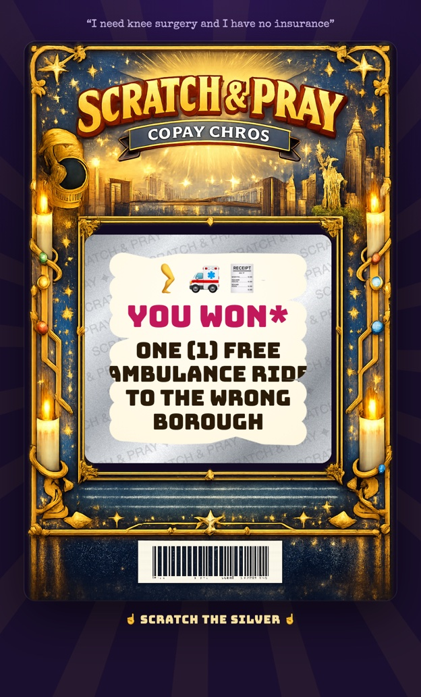

# Scratch & Pray 🙏

**The NYC lottery for basic needs.** A satirical art piece made for the **3percentclub Spooky Hackathon**.

▶ **Play it:** https://scratch-n-pray.pages.dev (works best on a phone)

Tell the city what you need. Buy a ticket. Scratch the silver. Pray.

<p align="center">
  
  <br>
  <em>Prayed for knee surgery. Won an ambulance ride to the wrong borough.</em>
</p>

---

## Why this exists

The idea came out of a conversation about how getting your needs met in America, and in New York City especially, often feels less like a system and more like **gambling**. You enter the housing lottery. You hope your name comes up on the waitlist. You call 311 again. You reapply for the benefit you already qualified for. You wait to see if the loan forgiveness program you were promised still exists. Whether you get food, a home, medical care, legal status or an education can come down to timing, paperwork, the caseworker you happened to get, and luck.

So we built the lottery. **Scratch & Pray** turns that feeling into an object: a kitschy, glowing scratch-off ticket, half state-lottery and half prayer candle, that promises to solve your problem if you're lucky enough.

## How it plays

1. You type a **prayer**: the thing you actually need. *"I haven't eaten in three days." "My landlord is evicting me." "I need surgery and I have no insurance." "I need a green card." "Please forgive my student loans."*
2. A custom ticket is **printed for you**. AI generates a one-of-a-kind ticket design themed around your need.
3. You **scratch off the foil** with your finger or mouse to reveal your prize.
4. **1 in 10 tickets** is a jackpot that genuinely solves your problem.
5. The other **9 in 10** are monkey's paws. Your wish is granted, technically, and it's cursed:

| You prayed for… | You won… |
|---|---|
| A meal | Leftovers from the 3 Pizza dumpster on 14th St (crusts only, still warm-ish) |
| A green card | One (1) Get Out of ICE Free Card*, or a weekend trip to New Jersey |
| Surgery | One free ambulance ride to the wrong borough, or two ibuprofen and a "there there" pat on the head |
| Student loan forgiveness | An invitation to audit one night class at City College |
| Housing | A 4-year spot on the waitlist for the waitlist |

*\*Not valid anywhere.*

## The spooky part

The monkey's paw is the horror story at the center of this project: the wish that comes true in the worst possible way. For a lot of New Yorkers that isn't a campfire tale. It's the shelter bed that's two hours from your kid's school, the "affordable" unit that costs 80% of your income, and the insurance approval that arrives after the surgery date. The scariest thing in this city isn't a ghost. It's a form that says *"Your application has been received."*

## The point

Scratch & Pray is satire. It punches **up**, at systems, bureaucracy, landlords, insurers and agencies, and never at the person praying. The jokes are meant to sting a little, because the reality behind them does.

Every ticket, win or lose, ends with a sincere **"For real, though"** line that points to a real resource for that need, such as NYC Care, Legal Aid Society, Housing Court Answers, City Harvest or 311. If a prayer suggests someone is in crisis, the joke steps aside and the ticket shows **988** (Suicide & Crisis Lifeline).

The goal is awareness. Behind every prayer someone types into this thing is a real need that a lot of New Yorkers are waiting on right now, with odds a lot worse than 1 in 10.

> **If you need help right now:** call or text **988** for crisis support, call **311** for NYC services, or visit [nyc.gov](https://www.nyc.gov).

---

## How it works

```
your prayer ─▶ server-side RNG (1 in 10) ─▶ LLM writes the prize ─▶ image model paints the ticket ─▶ scratch-off in the browser
```

- **Frontend:** a single HTML page with a canvas scratch layer, scratch sounds, haptics and confetti for winners. It can be installed as a phone app (PWA).
- **Backend:** Cloudflare Pages Functions. OpenAI writes the prize (`gpt-5.4-mini`, constrained to a JSON schema) and paints the ticket (`gpt-image-1.5`). Tickets are stored in Cloudflare R2.
- **Fairness:** the server rolls the dice, so the odds can't be gamed from the browser. Real life could take notes.

## Run it locally

```bash
npm install
npm run dev     # node --watch server.js → http://localhost:5177
```

The local server has no runtime dependencies. It needs Node 18+ and `OPENAI_API_KEY` in `.env`.

## Pipeline details

```
prayer ─▶ RNG (crypto.randomInt, 1 in SP_JACKPOT_ODDS) ─▶ text model writes prize JSON ─▶ image model paints ticket art ─▶ UI
```

1. **`POST /api/pray`** (`server.js` locally, `functions/api/pray.js` on Cloudflare; both call `lib/pipeline.js`): `{ prayer }`. The server rolls the jackpot, so the client can't cheat.
2. **Prize writer**: `SP_TEXT_MODEL` with a strict JSON schema returns `category, game_name, headline, prize, description, fine_print, real_help, crisis, symbols, card_theme`. The tone rules live in `SYSTEM_PROMPT`.
3. **Ticket art**: `SP_IMAGE_MODEL` at 1024×1536 renders an ornate border with an empty central window. The prompt asks for the window at about 41–78% of the height.
4. **UI** (`public/index.html`): finds the blank window in the art (`findWindow`, which looks for a flat or transparent region, because the model moves it around), puts the prize panel and a canvas foil layer there, and auto-reveals once about 55% of the foil is scratched. Includes scratch sound, haptics, confetti on a jackpot, a "for real, though" line pointing to a real resource, and 988 when `crisis` is true.

Every ticket is saved to `generated/<id>.json` and `.png`.

## Dev knobs

| URL param | Effect |
|---|---|
| `?force=win` / `?force=lose` | Override the RNG |
| `?art=0` | Skip image generation (fast and cheap text-only iteration) |
| `?replay=<id>` | Re-render a saved ticket from `generated/`, no API calls |
| `&scratch=0.85` | With `replay`, pre-scratch the foil by that amount (for screenshots like the one above) |

| Env | Default |
|---|---|
| `SP_TEXT_MODEL` | `gpt-5.4-mini` |
| `SP_IMAGE_MODEL` | `gpt-image-1.5` |
| `SP_IMAGE_QUALITY` | `medium` (`low` is faster and cheaper) |
| `SP_JACKPOT_ODDS` | `10` |
| `PORT` | `5177` |

It's a PWA (manifest and service worker), so on a phone you can use "Add to Home Screen". The phone has to reach the server over LAN or a tunnel.

## Deploy (Cloudflare Pages)

Live at **https://scratch-n-pray.pages.dev**. The UI is static files from `public/`. The API is Pages Functions in `functions/`, which uses the same `lib/pipeline.js` as the local server. Config lives in `wrangler.toml`.

```bash
npm run deploy                 # manual deploy; pushes to main deploy automatically via GitHub Actions
npm run cf:dev                 # local Cloudflare build on :8788 (simulated R2, key from .dev.vars)
```

- **Secret:** `OPENAI_API_KEY`, set once with `npx wrangler pages secret put OPENAI_API_KEY --project-name scratch-n-pray`.
- **R2:** `scratch-n-pray` holds the public ticket art and records (served at `/generated/*`). `scratch-n-pray-raw` is private: request logs with a hashed IP under `log/<day>/`, plus the rate-limit and budget counters under `limits/<day>/`.
- **Guard rails:** 3 tickets per minute and 12 per day per IP. Estimated spend is counted against `DAILY_BUDGET_USD`. Once it passes the cap, tickets come without art. At 1.2× the cap, the booth closes until midnight UTC. The counters live in R2, so they're approximate under heavy concurrency, which is fine for a demo.

---

*Made with 🕯️ for the 3percentclub Spooky Hackathon. Prizes are not redeemable for cash, dignity, or a callback.*
